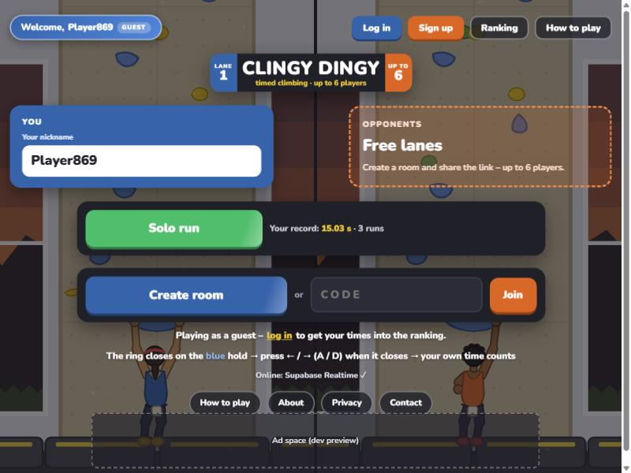
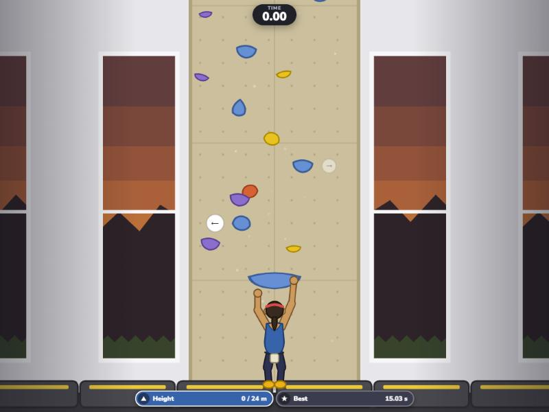
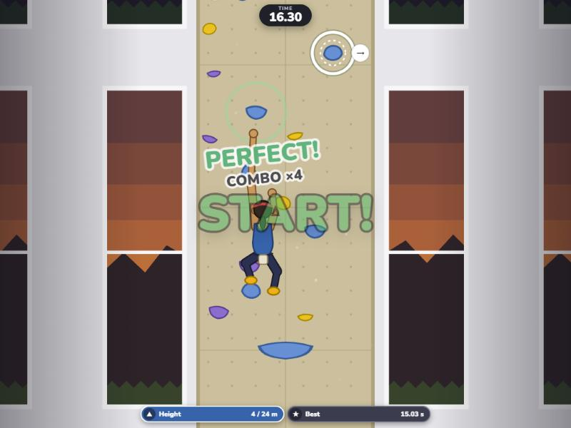
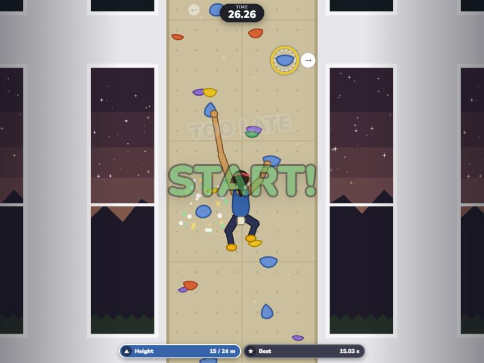
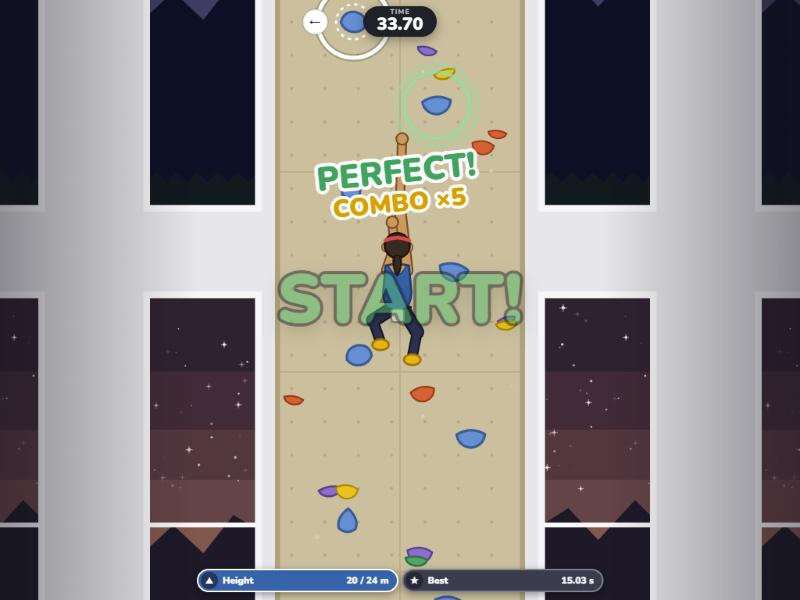
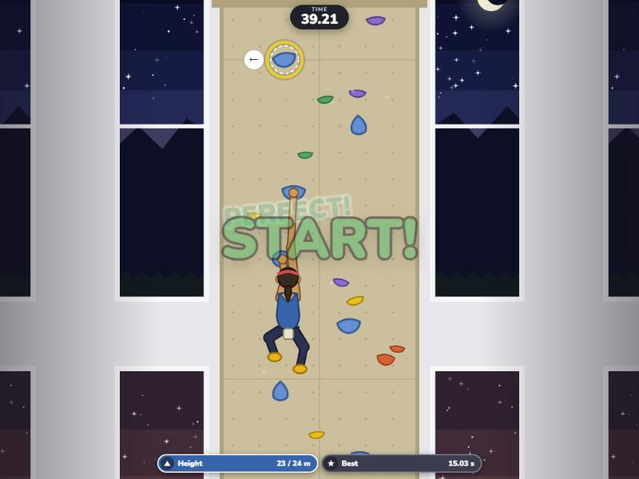
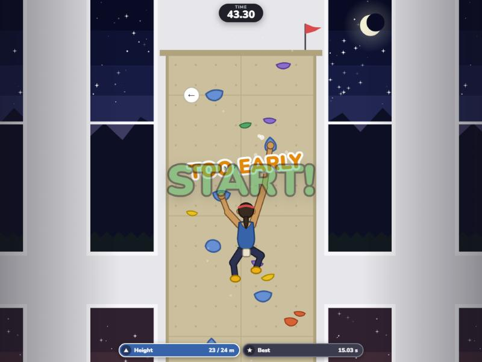
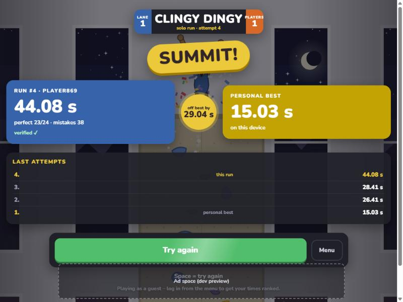
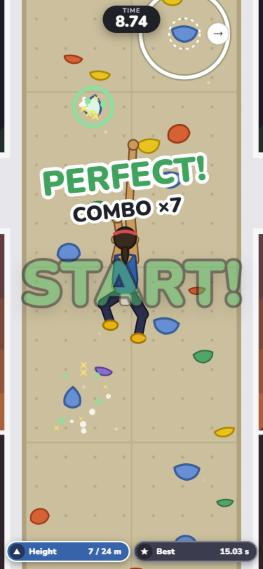

# Clingy Dingy 🧗

**A rhythm-based climbing duel that runs in the browser.** Race up a gym wall by hitting the beat, solo or against up to five friends, and watch their climbs live on a split screen. No install, no sign-up needed.

### ▶ [Play it live](https://irekmi.github.io/clingy-dingy/)

> Built end to end as a portfolio project: game design, a real-time multiplayer layer, a server that does not trust the client, accounts and rankings, CI/CD, and a responsive UI. Everything below is implemented and deployed.

## Screenshots

Everything you see is drawn in code on a Canvas 2D (no sprites or image files): the wall, holds, climber, windows, stars and moon. The hall slowly turns from sunset into a starry night as you climb.

| Menu | Start | Climbing at sunset |
|---|---|---|
|  |  |  |

| First stars | Dusk | Night and moon |
|---|---|---|
|  |  |  |

| Summit | Results | Phone |
|---|---|---|
|  |  |  |

## How it plays

A ring closes on the next **blue** hold. When it closes, press the arrow for the side of the hold (`←`/`A` or `→`/`D`; on a phone, tap the left or right half of the screen).

| Timing | Result |
|---|---|
| **PERFECT** (±50 ms) | you climb and the tempo speeds up (combo) |
| **OK** (±120 ms) | you climb at the same pace |
| too early | a short stall, tempo resets |
| wrong hand | you slip one hold down |

- **Solo run**: beat the clock, set a personal record, retry instantly.
- **Duel / room of up to 6**: share a link, everyone clicks *Ready*, race, rematch. Your wall is large, the others are shown live next to it (a live standings panel for 4–6 players, ranking capsules on phones).
- **Accounts and rankings**: play as a guest or log in; a global ranking of verified best times, a per-room ranking across rematches, and a personal history.

## What it demonstrates

| Area | What was built |
|---|---|
| **Real-time multiplayer** | Supabase Realtime: *Presence* for the lobby and readiness, *Broadcast* for positions. Each client measures **its own time locally**, so network lag never changes a result. |
| **Server-side trust** | The result is not a number the client sends. It is the replay of the player's **input log** through the same deterministic simulation (`sim.ts`) that runs in the browser *and* in Deno Edge Functions. A forged time does not reproduce. |
| **Anti-cheat** | Matches are created by the server (only participants can submit, once); a wall-clock check rejects runs faster than physically possible; statistical bot detection flags inhuman timing (too uniform, frame-perfect). Suspect runs are stored for review but kept out of the ranking; the server decides the winner. |
| **Auth and data** | Supabase Auth (e-mail + password, confirmation, reset), Postgres with **Row Level Security**, SQL views for the rankings and the player's history, versioned migrations. |
| **Rendering** | Hand-drawn **Canvas 2D** scene: procedurally generated routes, a climber built from interpolated poses (reach, pull-up, slip, summit, idle, chalk-up), move tweening, particles, six character looks, parallax. All drawn in code, no sprite sheets. |
| **UI / UX** | A responsive HUD that never covers the wall, a phone layout built around ranking capsules, animated menus (respecting `prefers-reduced-motion`), accessible labels. |
| **Delivery** | TypeScript throughout, Vite, Vitest, GitHub Actions deploying to GitHub Pages on every push to `main`. |

## Architecture

```
GitHub Pages ── static front end (Vite + TypeScript + Canvas 2D)
      │
      │  WebSocket                                        HTTPS
      ▼                                                    ▼
Supabase Realtime                          Supabase Edge Functions (Deno)
  room channel: Presence + Broadcast         create-match   → creates the match, fixes the start time
                                             submit-result  → replays the input log, checks time and
                                                              statistics, stores the verdict
                                                    │
                                                    ▼
                                         Postgres (RLS): matches, race_results, profiles
                                         views: leaderboard, my_results
```

**How a fair race works**

1. The server creates the match and returns a `matchId`; every player derives the **same route** from it.
2. Each client counts down 3 s *locally* and measures its own time from its own START signal.
3. Every key press is logged as `[time_ms, side]`. The time of a run is *computed from that log*, not reported.
4. At the finish the log goes to the opponents (who verify it client-side) and to the Edge Function (which verifies it authoritatively and records the winner).

`supabase/functions/_shared/sim.ts` is one file imported by both the browser and the server. That is the whole trick: identical code on both sides means a result cannot be argued with.

## Tech stack

TypeScript · Vite · Canvas 2D · Supabase (Realtime, Auth, Postgres + RLS, Edge Functions on Deno) · Vitest · GitHub Actions · GitHub Pages

## Project structure

```
src/main.ts                 room flow: lobby, countdown, race, results; menus; solo mode; routing
src/game/render.ts          the Canvas scene: wall, holds, climber poses and animation, particles
src/net/                    transports: Supabase Realtime, local (BroadcastChannel), solo (no-op)
src/account.ts              auth, profile, ranking and history queries
src/solo.ts                 personal records of the solo mode (localStorage)
src/pages.ts, src/ads.ts    info pages and the (optional) ad slot
supabase/functions/_shared/sim.ts   deterministic simulation + run analysis, shared by client and server
supabase/functions/         create-match, submit-result (Edge Functions)
supabase/migrations/        database schema, RLS policies, views
tests/sim.test.ts           simulation and anti-bot tests
docs/                       SETUP.md (run, deploy), ROADMAP.md (plans, design decisions)
```

## Run it locally

```bash
npm install
```

```bash
npm run dev
```

It works out of the box in **local mode** (no backend): try *Solo run*, or open a room link in two windows for a duel. Run the tests with `npm test`. Connecting your own Supabase project and deploying are covered in [docs/SETUP.md](docs/SETUP.md).

## Decisions and trade-offs

- **Local timer, server replay** instead of streaming every frame: cheap to run, immune to lag, and still verifiable. The cost is that a perfect bot could in theory produce a plausible log, which is why timing statistics and moderation exist on top.
- **Free to play, ad-supported** (AdSense prepared but off until a domain and consent banner are in place): paid entry and payouts were dropped on purpose to avoid gambling regulation and payment handling.
- **No backend of my own**: Supabase covers realtime, auth and data, so the whole project deploys as static files plus a few Edge Functions.

## Roadmap

Moderator panel for flagged runs, a character configurator, e-mail change and account deletion, interstitial ads every 5 solo attempts, and a “falling” fail state for the solo mode. Details and status: [docs/ROADMAP.md](docs/ROADMAP.md).
